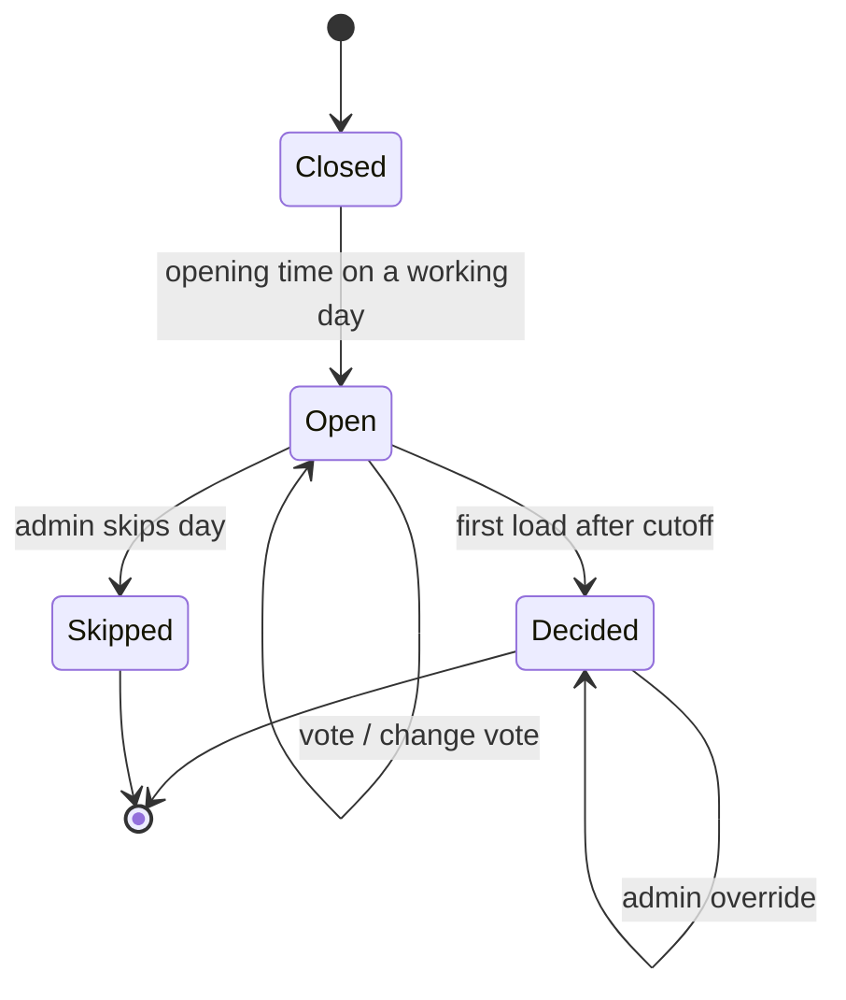

# PRD — Snack Voting

**Status:** Approved · **Date:** 2026-10-15 · **Slug:** `snack-voting` · **Owner:** masnun-siam · **Priority:** medium · **Repo:** none yet (greenfield)

This document is the source of truth for the feature: the task list and every issue are derived from it, and a decision that is not written here has not been made.

## Overview

A small website the whole office opens each working day. Every employee picks their name, votes for the snack they want that evening, and the snack with the most votes wins and is the one bought. Employees can also suggest new snacks; admins approve them and run the menu.

Today:
- Snacks are bought from outside and handed out; staff have no say, so many people get snacks they dislike.
- Nothing exists yet: no site, no menu list, no record of past choices.

## Problem

Every evening the office provides snacks chosen by whoever buys them. Some items are liked, some are not, and employees have no way to say what they want. The result is wasted snacks and unhappy staff.

## Users

- **Employee** — picks their name, votes, sees live counts and past results, suggests snacks.
- **Admin** — protected by a shared PIN; manages employees and the menu, approves suggestions, configures the voting window, overrides or skips a day, and places the actual order outside the app.

## Goals

- Every employee can vote for today's snack in under 30 seconds from a phone.
- The most-voted snack is clearly shown as the day's winner after cutoff, and does not change once decided.
- Very low infrastructure: everything runs on Cloudflare's free tier, no servers to maintain.

## Non-goals

- Real authentication (company login, passwords). Name-pick only for voters.
- Notifications or reminders (Slack, email, push).
- Budget or per-snack cost tracking, ordering or supplier integration.
- Ranked or multi-choice voting; photos, descriptions, dietary filters on snacks.
- Showing who voted for what, to anyone including admins.
- Multiple offices, teams or separate menus.

## Requirements

- **FR-1 Pick your name.** A voter chooses their name from the active employee list; the choice is remembered in that browser and can be changed ("not you?").
  - Acceptance: after picking a name and reloading, the same name is still selected; choosing another name switches identity; deactivated employees are not listed.
- **FR-2 Daily voting window.** On each working day (Monday to Friday by default) voting is open from the opening time to the cutoff, default 09:00 to 14:00 Asia/Dhaka, configurable by admins. Outside the window, voting is closed.
  - Acceptance: a vote sent before opening or after cutoff is rejected with a clear message; the page shows "opens at …", "open until …" or "closed" correctly for the current time.
- **FR-3 Cast and change a vote.** An employee gives exactly one vote per day to one approved, active snack and may change it until cutoff.
  - Acceptance: voting twice leaves one vote, for the latest snack; the counts reflect the change immediately; a vote for a retired or unapproved snack is rejected.
- **FR-4 Live counts.** While voting is open everyone sees each snack's vote count and the current leader. Nobody sees who voted for what.
  - Acceptance: counts update on reload (and by polling every 15 seconds); no screen or response lists voter names against snacks.
- **FR-5 Winner.** At the first load after cutoff the day's result is decided and stored: the snack with the most votes. A tie picks randomly among the tied snacks. Zero votes means no winner, and the page says the admin chooses.
  - Acceptance: the result never changes on later loads; a tie result says it was a random pick among the tied snacks; a day with no votes shows "no votes, admin's choice".
- **FR-6 Suggest a snack.** An employee suggests a snack by name (1 to 60 characters, trimmed). A suggestion that matches an existing snack or pending suggestion (case-insensitive) is rejected. Each employee may have at most 3 pending suggestions.
  - Acceptance: a fourth pending suggestion and a duplicate name are each rejected with a message; a valid one shows as pending to admins and is not votable.
- **FR-7 Admin menu management.** An admin approves or rejects suggestions, adds snacks directly, renames them and retires them. Retired snacks stop being votable and keep their history.
  - Acceptance: an approved snack appears on the vote screen at once; a retired snack disappears from voting but still appears in past results.
- **FR-8 Admin employee management.** An admin seeds the employee list by pasting names (one per line), and can add, rename and deactivate employees. Deactivating keeps the employee's past votes counted in past results.
  - Acceptance: pasting a list creates those employees and skips existing names; a deactivated employee cannot be picked or vote but old results are unchanged.
- **FR-9 Admin access.** The admin area requires a shared PIN, held as a deployment secret. Wrong PINs are rejected.
  - Acceptance: admin endpoints return 401 without a valid PIN; the PIN is never present in client code or the repo.
- **FR-10 Admin day control.** Before cutoff an admin may skip the day (holiday, voting closed with a message) and, after the result, override the winner with any snack. An override is shown as such.
  - Acceptance: a skipped day accepts no votes and shows "no snacks today"; an overridden result shows the new winner marked "set by admin".
- **FR-11 Admin settings.** An admin edits the opening time, the cutoff time and the working weekdays.
  - Acceptance: changing the cutoff takes effect for the current day if it is still open; the cutoff must be later than the opening time.
- **FR-12 History.** Everyone can see the last 30 days of results: date, winner, vote counts per snack, and how it was decided (votes, random tie pick, admin override, no votes, skipped).
  - Acceptance: history lists decided days only and shows no voter names.
- **FR-13 Repo docs.** The repo carries the docs a maintainer expects: `README.md`, `CLAUDE.md`, `CONTRIBUTING.md`, `LICENSE` (MIT, "2026 Masnun Siam"), `docs/architecture.md`, `docs/quickstart.md` and `docs/deploy.md`. Each describes what exists today and marks anything not built yet as "Planned".
  - Acceptance: every file exists; the quickstart takes a fresh clone to a running local site and a passing `npm test` using only commands that work; the deploy guide covers creating the Pages project and D1 database, replacing the placeholder database id, setting the `ADMIN_PIN` secret, the two repo secrets for deployment, and the token's minimum scopes (Pages edit, D1 edit); no doc contains a secret value.
- **FR-14 Deploy workflow.** A GitHub Actions workflow deploys to Cloudflare Pages on every push to `main`, after the tests pass: it applies D1 migrations to the production database, then deploys the `public` site with its functions through Wrangler. Pull requests run the tests only, with no preview deploy.
  - Acceptance: a push to `main` with passing tests updates the live site; failing tests or a failing migration stop the run before any deploy; a pull request never deploys; the workflow file contains no credential values.

- **FR-15 Visual design.** Every screen (name picker, vote list, suggestion form, history, admin) has a deliberate, polished look instead of default browser styling: a warm and playful direction (cream background, a warm tomato or amber accent, rounded cards, a friendly display font), a consistent type scale, colour palette and spacing, clear states for open, closed, decided and skipped, and it stays mobile-first.
  - Acceptance: the same design system styles the voter and admin pages; text contrast meets WCAG AA; no screen shows unstyled default controls; the layout works from 360px wide up.

*A day's lifecycle; the Decided state is written once and then frozen.*

## Edge cases

- **Concurrency.** Two people voting at once never produce more than one vote per employee per day (database uniqueness). Two loads right after cutoff both try to decide the day; only one result is stored and both see the same winner.
- **Empty states.** No approved snacks: the page says voting is not possible and admins are pointed to the menu. No employees: admins are told to add some. No votes: see FR-5.
- **Limits.** 3 pending suggestions per person; snack name 60 characters; employee name 1 to 60 characters, unique case-insensitively.
- **Clock.** Open and cutoff are judged on the server clock in Asia/Dhaka, never the browser's. A tab left open past cutoff gets a rejection when it votes.
- **Impersonation.** Anyone can pick someone else's name; accepted for this internal low-stakes tool. A vote overwrite by another person is possible and accepted.
- **Admin override races.** An override replaces the stored winner; later loads show the override.
- **Deleted or missing data.** Employees and snacks are never hard-deleted, so history stays consistent. An employee deactivated mid-day keeps today's vote.
- **Existing data.** None to migrate; the employee list is seeded once by an admin.

## Technical design

### Data
One Cloudflare D1 (SQLite) database, no migrations beyond the initial schema.
- `employees` (id, name unique case-insensitive, active, created_at)
- `snacks` (id, name unique case-insensitive, status: pending | approved | retired, suggested_by employee id nullable, created_at) — serves FR-6, FR-7.
- `votes` (day date, employee_id, snack_id, updated_at), primary key (day, employee_id) — serves FR-3, FR-4.
- `results` (day primary key, status: decided | skipped, winner_snack_id nullable, method: votes | tie_random | admin | no_votes, counts snapshot as JSON, decided_at) — serves FR-5, FR-10, FR-12.
- `settings` (single row: open_time, cutoff_time, working_days) — serves FR-2, FR-11.
- The "day" is the Asia/Dhaka calendar date.

### API
All under `/api`, JSON. Voter endpoints are open; admin endpoints need header `X-Admin-Pin`.
- `GET /state` — voter-facing: today's status (closed | open | decided | skipped), window times, approved snacks with counts, the caller's current vote (given `?employee=<id>`), result if decided. Deciding the day happens here when past cutoff.
- `GET /employees` — active employees for the picker.
- `POST /vote` `{employee_id, snack_id}` — 403 closed, 404 unknown or inactive, 409 snack not votable.
- `POST /suggestions` `{employee_id, name}` — 409 duplicate, 429 over 3 pending.
- `GET /history` — last 30 decided days.
- Admin: `GET /admin/suggestions`, `GET /admin/snacks` (all snacks, any status, with suggester), `POST /admin/snacks` (add), `PATCH /admin/snacks/:id` (rename, approve, reject, retire), `GET /admin/employees` (all, including inactive), `POST /admin/employees` (bulk `{names[]}` or one), `PATCH /admin/employees/:id`, `GET /admin/settings`, `PUT /admin/settings`, `POST /admin/days/:day/skip`, `POST /admin/days/:day/override` `{snack_id}`. Wrong or missing PIN gives 401; PIN compare is constant-time.

### Backend
Cloudflare Pages Functions only; no cron and no Worker outside Pages. The day is decided lazily by the first `GET /state` after cutoff using an insert-if-absent on `results`, so concurrent callers converge on one row. The random tie pick happens inside that insert, so it is stored before anyone sees it.

### Frontend
A static, mobile-first single page served by Pages: name picker, snack list with counts and a vote button, suggestion form, history list, and an admin page behind the PIN prompt. States: loading, error with retry, closed, open, decided, skipped, no snacks. Counts refresh by polling every 15 seconds while open; no websockets.

### Deployment
- One GitHub Actions workflow with two jobs, test then deploy; deploy runs only on pushes to `main` and needs the test job — serves FR-14.
- Credentials are repo secrets `CLOUDFLARE_API_TOKEN` and `CLOUDFLARE_ACCOUNT_ID`; the Pages project is named `snack-voting`. `ADMIN_PIN` is a Pages secret set once by hand and never appears in the workflow.
- Deploy order: apply pending D1 migrations to the remote database, then publish the Pages project. A failed migration stops the deploy.
- The real D1 `database_id` is committed to `wrangler.toml` after the database is created (ids are not secret); the deploy guide says where to replace the placeholder.
- Docs (FR-13) describe only what is built and label the rest "Planned".

### Integrations and realtime
Not affected. No notifications, no external services.

### Non-functional
- Free tier only: Pages, Functions and D1 limits comfortably cover tens of employees.
- Admin PIN is a Pages secret, never committed or shipped to the browser except as typed by an admin (kept in session storage).
- No personal data beyond employee names; votes are never returned per person.
- Works on current mobile and desktop browsers.

### Testing
- API tests against a local D1 for FR-2 (window), FR-3 (one vote, change, rejected targets), FR-5 (winner, tie, no votes, frozen result, concurrent decide), FR-6, FR-9, FR-10, FR-11.
- Component or end-to-end tests for FR-1, FR-4, FR-7, FR-8, FR-12 screens including empty and error states.
- Manual check of a real-time cutoff on the deployed site.
- FR-13 and FR-14 are checked by review: docs against the commands they cite, and one real push to `main` for the workflow.

## Rollout and cost

All employees at once: share the site URL in the office channel. Operations before release: create the Cloudflare Pages project and D1 database, set the admin PIN secret, and have an admin paste the employee list and approve the first snacks. Cost is zero on the free tier.

## Success metrics

At least 70% of employees vote on a typical working day within 2 weeks of launch, and fewer complaints about the snack menu (informal check by the requester).

## Epics

- **E1 Snack Voting site** — covers FR-1 to FR-12. Issue: #1
- **E2 Repo docs and deploy** — covers FR-13 to FR-14. Issue: #58
- **E3 UI redesign** — covers FR-15. Issue: #73

## Decisions

- UI polish is requirement FR-15 in a new epic E3, built with the frontend-design skill — the requester called the current UI the ugliest they have seen, and a decision not in the PRD has not been made.
- Repo docs and the deploy workflow are requirements FR-13 and FR-14 in a new epic E2, not side items — keeps the PRD the source of truth (raised by /create-prd on Tasks.md).
- Docs set is README, CLAUDE.md, CONTRIBUTING.md, MIT LICENSE (2026 Masnun Siam), docs/architecture.md, docs/quickstart.md, docs/deploy.md; they document what exists and mark planned parts "Planned" — a maintainer-ready repo without promising unbuilt features.
- Deploy on push to `main` only, after tests pass; no PR preview deploys — smallest workflow for a tens-of-users internal tool.
- The workflow applies D1 migrations before deploying — schema stays in step with code and a bad migration blocks the release.
- Credentials are repo secrets `CLOUDFLARE_API_TOKEN` and `CLOUDFLARE_ACCOUNT_ID`, Pages project `snack-voting` — standard Wrangler setup; the PIN stays out of CI.
- The real D1 database id is committed to `wrangler.toml` once created — D1 ids are identifiers, not secrets, and this avoids injecting it at deploy time.

- Voters pick their name from a list, no password — simplest for a small trusted office; impersonation accepted.
- Admin area uses one shared PIN stored as a secret — minimal protection without accounts.
- Employees suggest snacks, admins approve — keeps the menu curated without admins doing all the typing.
- Voting 09:00 to 14:00 Asia/Dhaka on weekdays, configurable — covers the evening-snack order lead time.
- Tie is a random pick among tied snacks; no votes means the admin chooses — fair and needs no extra history.
- Votes are changeable until cutoff and counts are live; nobody sees who voted for what — transparency of totals without social pressure.
- Hosted entirely on Cloudflare Pages + Functions + D1 with no cron; the day is decided lazily on first load after cutoff — lowest infrastructure, free tier.
- D1 over Workers KV — needs a uniqueness constraint for one vote per person per day.
- Admins can skip a day and override a winner — handles holidays and real-world constraints.
- Employees and snacks are deactivated or retired, never deleted — keeps history intact.
- Priority medium, success measured by 70% participation — internal nice-to-have.
- The admin places the order outside the app — ordering is not in scope.
- FR-15 aesthetic direction is warm and playful: cream background, warm accent (tomato or amber), rounded cards, friendly display font — chosen by the requester on 2026-10-15; an inviting look suits an office snack vote on a phone (raised by /create-tasks).
- Rejecting a suggestion sets its status to retired — the snack status set has no other terminal value and snacks are never deleted (raised by /create-tasks).
- The admin screens read full lists through `GET /admin/snacks`, `GET /admin/employees` and `GET /admin/settings`, since the voter endpoints show only active or approved data — the admin UI cannot manage what it cannot list (raised by /create-tasks).

## Open questions

None

## Change log

- 2026-10-15 — reject = retire; added admin read endpoints GET /admin/snacks, /admin/employees, /admin/settings; issues affected: none (no task issues yet)

- 2026-10-15 — added FR-13 repo docs and FR-14 deploy workflow as epic E2, with a Deployment design section; issues affected: none (E1 issues unchanged; E2 needs an epic and tasks)

- 2026-10-15 — added FR-15 visual design as epic E3 (requester finds the current UI very ugly); issues affected: none (E1 and E2 issues unchanged; E3 needs an epic and tasks)
- 2026-10-15 — FR-15 aesthetic direction decided (warm and playful); open question resolved; issues affected: none (E3 has no issues yet)

## Related

- [[05-Work/Office Snacks/Snack Voting/Dump|Dump]] — problem statement
- [[05-Work/Office Snacks/Snack Voting/Tasks|Tasks]]
- [[05-Work/Office Snacks/Snack Voting/Decisions|Decisions]]
- [[05-Work/Office Snacks/Index|Office Snacks Project Index]]
